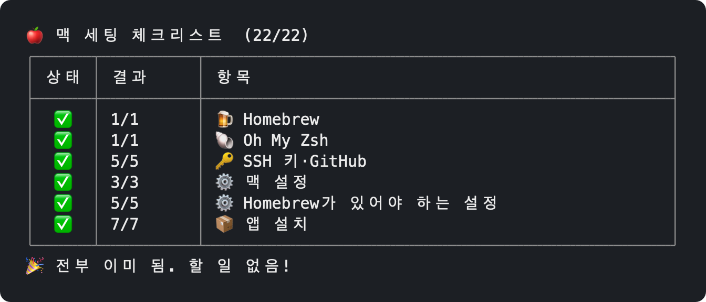

# 🍎 Initial MacBook Setup

[](https://github.com/myungjinki/initial-macbook-setup/actions/workflows/ci.yml)

포맷한 맥에서 **터미널**을 열고 이 한 줄 붙여 넣기. 끝. 미리 준비할 것 없음. 👍

```bash
bash -c "$(curl -fsSL https://raw.githubusercontent.com/myungjinki/initial-macbook-setup/main/mac-setup.sh)"
```

> 🤖 **설정·설치 추가는 AI로.** 이 저장소를 fork하고 Claude Code 같은 AI 코딩 도구에 "Slack 설치 추가해 줘", "Finder에서 숨김 파일 보이게 해 줘"처럼 말하면 됨. AI가 [AGENTS.md](AGENTS.md) 규칙대로 항목을 넣고, push하면 CI가 macOS에서 두 번 실행해 확인함. 순서는 [2장](#2-항목-추가하기).

- 요구 사항: macOS 27 · Apple Silicon에서 테스트(CI는 GitHub macos-latest). Intel 맥도 지원, 직접 확인은 안 함.
- 할 일만 미리 보기: 끝에 `_ --dry-run`. 아무것도 안 바꿈.

  ```bash
  bash -c "$(curl -fsSL https://raw.githubusercontent.com/myungjinki/initial-macbook-setup/main/mac-setup.sh)" _ --dry-run
  ```
- 입력은 맨 처음에만. 그다음은 자동.
  - `git 이름`·`git 이메일`
  - 비밀번호를 물으면 **관리자 비밀번호**
  - 새 SSH 키의 **키 암호 정하기** (두 번), `Enter passphrase`가 나오면 그 **키 암호** 한 번 더 (키체인에 저장, 다시 안 물음)
  - 브라우저가 열리면 **GitHub 로그인**: 클립보드에 복사된 코드 붙여 넣고 승인
- 첫 실행은 Homebrew가 Xcode Command Line Tools도 설치해서 10분 넘게 걸릴 수 있음.
- 끝나면 새 터미널 창 열기. 그래야 `brew`가 잡힘.
- 몇 번 다시 실행해도 안전. 실행 전 내용 확인은 [mac-setup.sh](mac-setup.sh).

실행 화면 (다 끝난 맥에서 다시 실행). 진행 중·실패한 묶음만 펼쳐짐.



## 1. 스크립트가 하는 것

진행 상황은 `상태 │ 결과 │ 항목` 표(⬜ 대기 → ⏳ 진행 중 → ✅ 완료/이미 됨, ❌ 실패, ➖ 꺼짐, ⏭️ brew 필요). 기본 터미널 창(80×24)에 들어가게 묶음은 한 줄로 접힘. 이미 된 항목은 "이미 됨"으로 건너뜀 → **몇 번 다시 실행해도 안전.**

| 묶음 | 항목 | 내용 |
|---|---|---|
| 1. Homebrew | Homebrew 설치 | |
| 2. Oh My Zsh | Oh My Zsh 설치 | brew 패키지가 없어 공식 스크립트로 설치, `~/.zshrc`가 없으면 기본 템플릿 생성 |
| 3. SSH 키·GitHub | SSH 키 | `~/.ssh/id_ed25519`가 없으면 새로 만들기 (옆에 키가 있으면 복사, 권한 600/644) |
| | `~/.ssh/config` | `UseKeychain yes`·`AddKeysToAgent yes` 추가 |
| | 키 암호를 키체인에 저장 | 맨 처음에 한 번 입력, 재부팅해도 다시 안 물음 |
| | GitHub 로그인 | 브라우저로 (옆에 `gh_token`이 있으면 그걸로). git은 SSH 방식, Homebrew 전이라 gh를 임시로 받아 씀 |
| | SSH 키를 GitHub에 등록 | 이미 있으면 건너뜀 |
| 4. 맥 설정 | 키 반복 | 속도 Fast, 지연 Short (로그아웃 후 적용) |
| | 음량 | 0 |
| | Dock | 기본 앱 전부 빼기 (Finder·휴지통은 남음) |
| 5. Homebrew가 있어야 하는 설정 | 내장 디스플레이 해상도 | "More Space"로 변경 (해상도 자동 판별) |
| | 내장 디스플레이 밝기 | 최대 |
| | git 사용자 | 이름·이메일 (`git config --global`) |
| | brew PATH | 새 터미널에서 `brew`가 잡히도록 `~/.zprofile`에 등록 |
| | git pull | rebase 대신 merge (`pull.rebase false`) |
| 6. 앱 설치 | Google Drive | |
| | Rectangle | 단축키로 창 정리 |
| | Chrome | |
| | Claude 데스크톱 | |
| | ChatGPT 데스크톱 | |
| | Discord | |
| | GitHub CLI (gh) | |

- 비밀번호는 Homebrew 설치나 pkg형 앱 설치가 남아 있을 때만 물음.
- 실패한 항목은 바로 아래에 로그 마지막 5줄. 전체 로그는 `~/Library/Logs/mac-setup.log`에 실행마다 이어서 쌓임.
- Homebrew가 없으면 brew가 필요한 항목(5·6번)은 ⏭️로 건너뜀.

## 2. 항목 추가하기

1. 이 저장소를 fork.
2. AI 코딩 도구에 원하는 설정·설치를 말하기. 형식과 규칙은 [AGENTS.md](AGENTS.md)에 있어서 AI가 알아서 따름.
3. 맨 위 명령과 README의 curl 주소에서 `myungjinki`를 내 GitHub 아이디로 바꿔서 실행.

## 주인 전용 설정 (선택)

내 취향. curl 한 줄이면 충분하고, 지금 쓰는 SSH 키를 그대로 가져가거나 입력을 줄이고 싶을 때만 저장소를 받아 `mac-setup.sh` 옆에 아래 파일을 두고 `bash mac-setup.sh`로 실행. 이 파일들은 `.gitignore`에 있어서 커밋 안 됨.

| 옆에 둘 파일 | 만드는 법 | 없으면 |
|---|---|---|
| `id_ed25519`, `id_ed25519.pub` | `cp ~/.ssh/id_ed25519* .` (지금 쓰는 SSH 키) | 새 키 만들고 GitHub에 등록 |
| `gh_token` | 아래 명령 | 브라우저로 GitHub 로그인 한 번 |

`gh_token`: **GitHub → Settings → Developer settings → Personal access tokens**에서 `repo`, `read:org`, `admin:public_key` 권한으로 만들고(만료 기간 두는 게 안전) 복사한 뒤 받은 폴더에서 저장. 만료되면 GitHub 로그인 항목이 ❌.

```bash
pbpaste > gh_token && chmod 600 gh_token
```

## 라이선스

[MIT](LICENSE)
